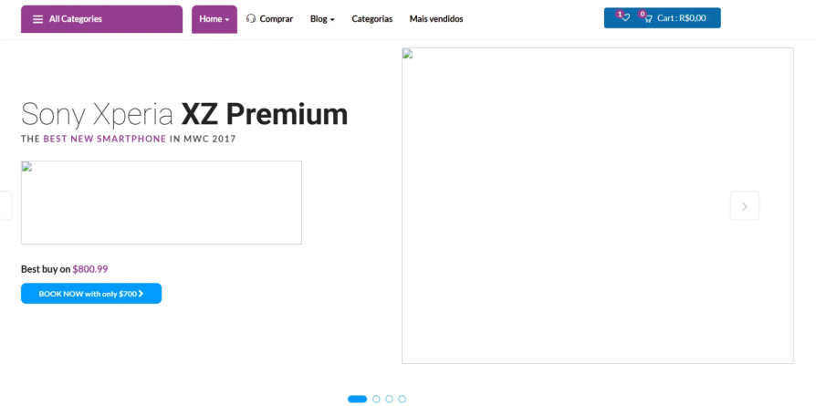
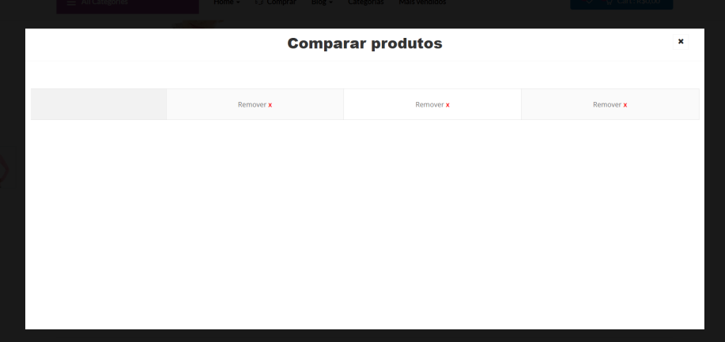
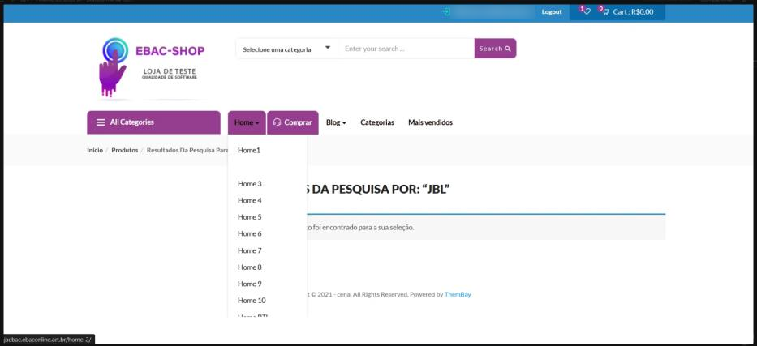
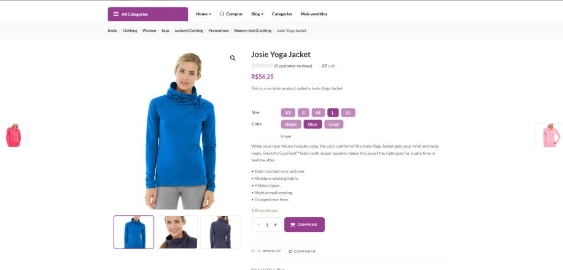

<div align="center">

# 🐞 Bug Report | EBAC Shop

**Análise de QA em um e-commerce de testes: bugs encontrados e melhorias propostas.**

Exercício do curso de **Engenheiro de Qualidade de Software** da EBAC.

<br />


</div>

---

## 📖 Sobre o projeto

Este projeto reúne a análise que fiz da **loja virtual de testes da EBAC**, aplicando na prática o que aprendi sobre **testes manuais**, **identificação de falhas** e **proposta de melhorias** em um sistema real.

O resultado foi documentado seguindo o **modelo profissional de Bug Report da EBAC**, com título, ambiente, URL, evidências, passo a passo para reprodução, resultado esperado e real, gravidade e prioridade.

🔗 **Sistema testado:** [lojaebac.ebaconline.art.br](http://lojaebac.ebaconline.art.br/)

## 🎯 Objetivo

Avaliar o e-commerce identificando:

- ✔️ Bugs funcionais
- ✔️ Problemas visuais
- ✔️ Oportunidades de melhoria
- ✔️ Inconsistências de usabilidade

## 🛠️ Abordagem de teste

- **Teste funcional**: verificar se as funcionalidades fazem o que deveriam
- **Teste exploratório**: navegar pelo sistema em busca de comportamentos inesperados
- **Teste visual**: conferir a aparência e o carregamento dos elementos
- **Validação de fluxo de navegação**: percorrer os caminhos que o usuário faria
- **Verificação de consistência de idioma**: checar o padrão dos textos
- **Registro estruturado de bugs** com documentação e evidências

## 📋 Resumo dos achados

| ID | Tipo | Título | Gravidade | Prioridade |
|:---:|:---:|---|:---:|:---:|
| **B001** | 🔴 Bug | Foto do produto não está aparecendo | Média | Alta |
| **B002** | 🔴 Bug | Comparação de produtos não funciona | Alta | Alta |
| **M001** | 🟡 Melhoria | Falta de contraste no site em si | Média | Média |
| **M002** | 🟡 Melhoria | Linguagem diversa (português e inglês misturados) | Alta | Alta |

## 📸 Evidências

### 🔴 B001: Foto do produto não está aparecendo

- **Onde:** página [Home](http://lojaebac.ebaconline.art.br/home/), opção Home 1
- **Esperado:** exibição dos produtos com a foto de cada um
- **Real:** a foto de nenhum dos produtos da página carrega



### 🔴 B002: Comparação de produtos não funciona

- **Onde:** página do produto *Augusta Pullover Jacket*, opção Comparar
- **Esperado:** mostrar uma opção para adicionar itens à comparação, facilitando a escolha do usuário
- **Real:** a janela "Comparar produtos" abre, mas os produtos selecionados não carregam



### 🟡 M001: Falta de contraste no site em si

- **Onde:** página [Home](http://lojaebac.ebaconline.art.br/home/), menu Home ao passar o mouse
- **Esperado:** evidenciar a seção em que o mouse está, para facilitar a visibilidade
- **Real:** a seção sobre a qual o mouse passa se camufla com o resto do site



### 🟡 M002: Linguagem diversa

- **Onde:** página do produto *Josie Yoga Jacket*
- **Esperado:** mostrar a descrição do produto em português ou manter o site inteiro em inglês
- **Real:** algumas opções do site aparecem em português e outras em inglês, sem padrão



## 📄 Documentação

O relatório completo, com todos os campos do modelo da EBAC, está disponível em PDF e abre direto no GitHub:

📕 **[Exercicio_Bug_Report.pdf](https://github.com/camilabernardis/Bug-report/blob/main/Exercicio%20Bug%20Report.pdf)**

## 📂 Estrutura do projeto

```
Bug-report/
├── Exercicio_Bug_Report.pdf    # Relatório completo (PDF)
├── README.md
└── evidencias/                 # Prints dos bugs e melhorias
    ├── b001-imagens-nao-carregam.png
    ├── b002-comparacao-nao-funciona.png
    ├── m001-falta-de-contraste.png
    └── m002-idioma-misturado.png
```

## 🧠 Competências demonstradas

- Atenção a detalhes
- Pensamento crítico
- Capacidade analítica
- Documentação estruturada
- Comunicação clara de problemas técnicos
- Foco em experiência do usuário

## 🙏 Agradecimentos

À **EBAC** pelo curso de Engenheiro de Qualidade de Software e pelo ambiente de testes.

## 👩‍💻 Autora

**Camila Bernardi**

[](https://github.com/camilabernardis)

---

<div align="center">

Feito com 💜 e um olhar atento para cada detalhe. 🔍

⭐ Se gostou do projeto, deixa uma estrelinha!

</div>
